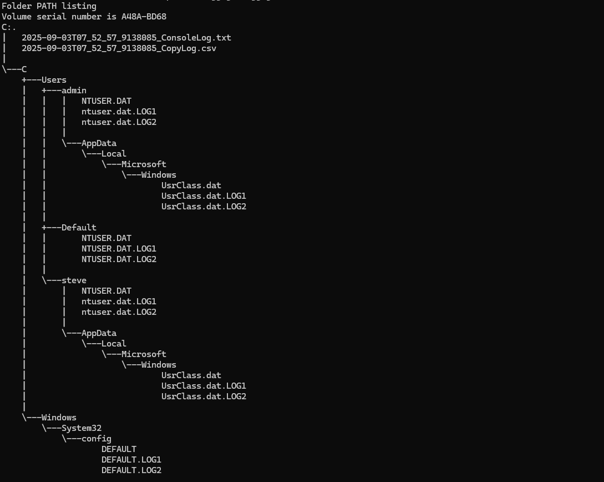
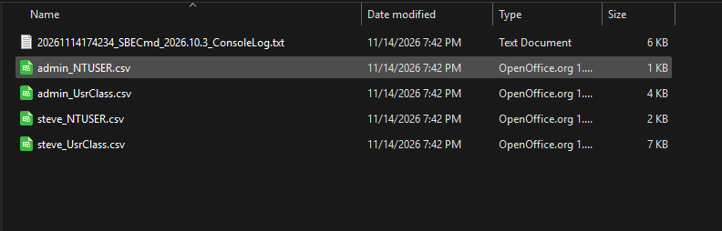
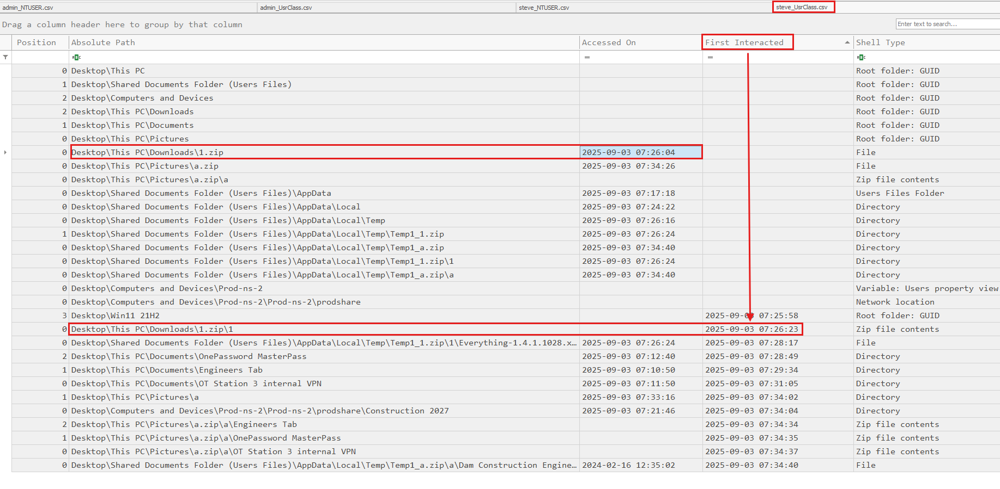
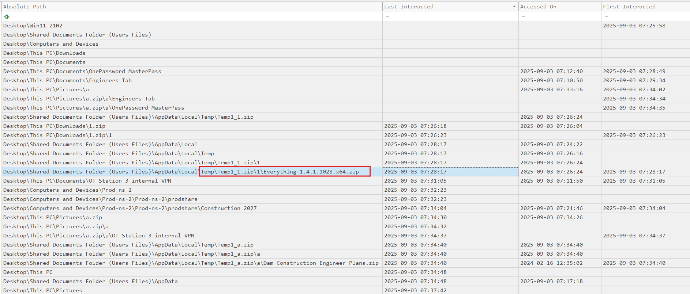
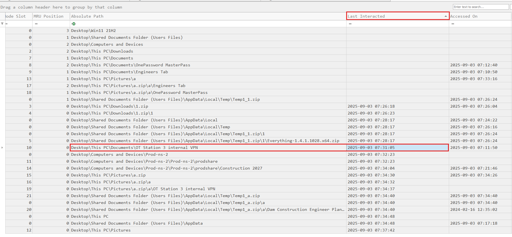
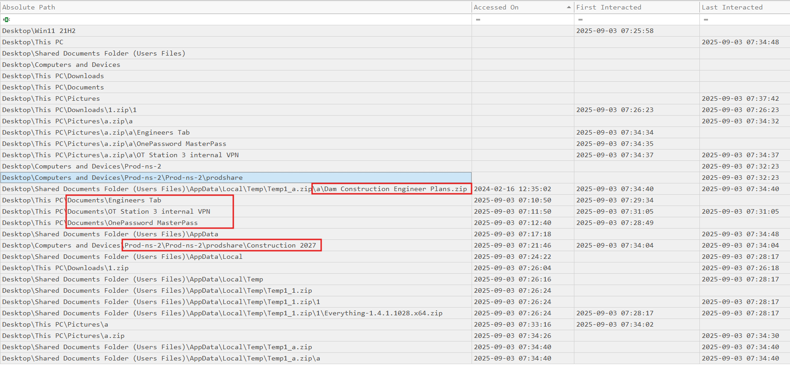
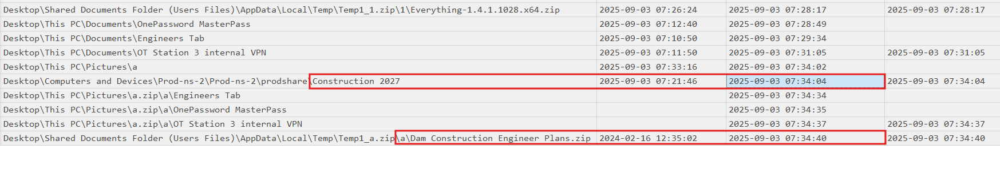
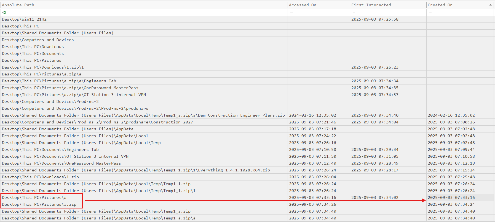
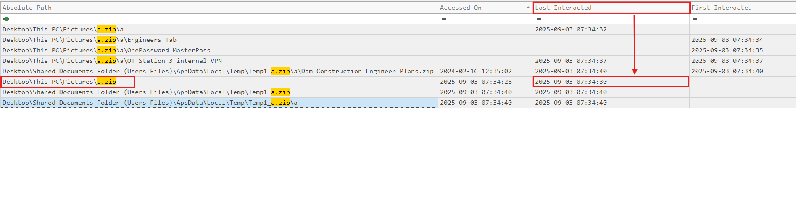

In this Sherlock, an attacker used the compromised account `steve` to bring a file search tool onto the workstation, browse sensitive folders and a network share, and stage the data in a zip archive for exfiltration. The evidence was a KAPE triage collection of the users' registry hives, so the investigation relies on shellbags. All timestamps are in UTC.

## Summary

### Accounts

| Account | Description                              |
| ------- | ---------------------------------------- |
| steve   | Compromised account used by the attacker |
| admin   | Second user account on the workstation   |

### Key locations

| Item                 | Path                                                                         |
| -------------------- | ---------------------------------------------------------------------------- |
| Downloaded archive   | `C:\Users\steve\Downloads\1.zip`                                             |
| Search tool          | `Everything-1.4.1.1028.x64.zip`                                              |
| Network share        | `\\Prod-ns-2\prodshare`                                                      |
| Archive on the share | `\\Prod-ns-2\prodshare\Construction 2027\Dam Construction Engineer Plans.zip` |
| Staging folder       | `C:\Users\steve\Pictures\a`                                                  |
| Exfiltration archive | `C:\Users\steve\Pictures\a.zip`                                              |

## 1. The evidence



The collection holds the registry hives of both users. The most important files are each user's `NTUSER.DAT` and `UsrClass.dat`, which contain the shellbags.

> **What are shellbags?**  
> When someone opens a folder in Windows Explorer, Windows saves how that folder looked: window size, icon or details view, sort order. It does this so the folder looks the same next time it's opened. That saved data is a shellbag. As a side effect, it records which folders the user opened, even folders that no longer exist.
{: .prompt-info }

## 2. Parsing the shellbags

I parsed the hives to CSV with SBECmd, the command-line version of ShellBags Explorer:

```powershell
$directory = ".\Baggage\C"
$output    = ".\Output"

SBECmd -d "$directory\Users" --csv "$output\ShellBags"
```

SBECmd writes one CSV per hive:



The hives belong to two user accounts, `admin` and `steve`. I opened the CSVs in Timeline Explorer to work through the events.

## 3. The downloaded archive

Sorting `steve_UsrClass.csv` by the First Interacted field, I found a folder named `1` inside `1.zip`:



There are two archives of interest:

```
Desktop\This PC\Downloads\1.zip
Desktop\This PC\Pictures\a.zip
```

Each has an entry for its contents, with the shell type `Zip file contents`:

```
Desktop\This PC\Downloads\1.zip\1
Desktop\This PC\Pictures\a.zip\a
```

The Last Interacted timestamps of the two archives are:

| File  | Timestamp           |
| ----- | ------------------- |
| 1.zip | 2025-09-03 07:26:18 |
| a.zip | 2025-09-03 07:34:30 |

This suggests that the files inside the archives were opened or extracted to temporary locations.

### The search tool



The archive `Everything-1.4.1.1028.x64.zip` came out of `1.zip`, either extracted or opened without extraction. Everything is a free Windows file search tool from voidtools. It builds an index of all the files and folders on NTFS drives by reading the file system's master file table (MFT) and USN journal directly, so searches return results almost instantly. That also makes it useful to an attacker looking for valuable files.

### Key findings

- Archive downloaded by the compromised account: `1.zip`
- Utility brought in to search for sensitive data: Everything 1.4.1.1028

## 4. Sensitive folders

The attacker browsed folders that the victim used in their day-to-day work. The internal VPN folder was last accessed at 2025-09-03 07:31:05:



The other sensitive folders and the network share appear in the same CSV:



| Path                                                                         | Timestamp           |
| ---------------------------------------------------------------------------- | ------------------- |
| `C:\Users\steve\Documents\OnePassword MasterPass`                              | 2025-09-03 07:28:49 |
| `C:\Users\steve\Documents\Engineers Tab`                                       | 2025-09-03 07:29:34 |
| `C:\Users\steve\Documents\OT Station 3 internal VPN`                           | 2025-09-03 07:31:05 |
| `\\Prod-ns-2\prodshare\Construction 2027`                                      | 2025-09-03 07:32:41 |
| `\\Prod-ns-2\prodshare\Construction 2027\Dam Construction Engineer Plans.zip` | 2025-09-03 07:34:04 |

Each timestamp is when steve opened or browsed the item in Explorer. Shellbags can't show which files inside these folders were read.

### Key findings

- Directory containing the victim's passwords: `OnePassword MasterPass`
- Network share accessed to pillage network data: `\\Prod-ns-2\prodshare`
- Year the dam construction is planned: 2027
- Archive on the network share: `Dam Construction Engineer Plans.zip`

## 5. The engineer plans archive



The `Dam Construction Engineer Plans.zip` archive was accessed at 2025-09-03 07:34:04, but its First Interacted field shows 2025-09-03 07:34:40. The two timestamps come from two different shellbag entries for two different copies of the same file. At 07:34:04 steve opened the original on the network share. At 07:34:40 steve looked inside his own `a.zip` afterwards.

## 6. Staging and compression

The staging folder holds the sensitive files above. Its path in the shellbags is `Desktop\This PC\Pictures\a`, and its path on the file system is `C:\Users\steve\Pictures\a`.

Sorting by the Created On field shows how the files were staged:

1. steve created the folder `a` in Pictures at 07:33:16.
2. He copied the sensitive files into it.
3. He compressed the folder into `a.zip` at 07:34:24.



### Last interaction with the exfiltration archive

The Last Interacted field shows that the exfiltration archive `a.zip` was accessed at 2025-09-03 07:34:30:



About 9 minutes passed from the tool arriving to the archive being ready (07:25:48 to 07:34:30). The attacker brought in a search tool, found credentials, VPN and engineering data, pulled the dam plans from the production share, then staged everything in a folder with a generic name (`Pictures\a`) and zipped it. Shellbags can't show whether `a.zip` left the host.
